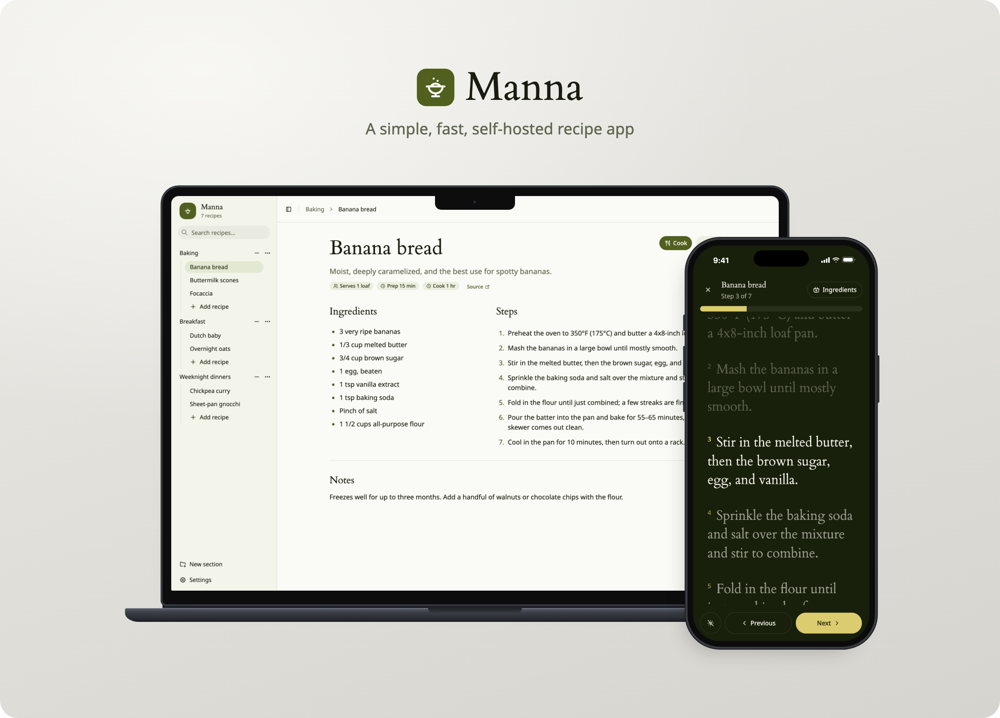

# Manna

Manna is a simple, fast, self-hosted recipe app. Organize recipes into sections, then follow them step by step in cook mode on your phone, tablet, or desktop.



## Features

- **Sections and recipes** in a sidebar: create, rename, and delete sections, and search recipes by title or section. On phones, swipe right to open the sidebar and left to close it.
- **Home page** with the recipes you opened most recently and the newest ones you added, so the ones you're cooking this week are a tap away.
- **Recipes** with a description, servings, prep and cook times, a source link, ingredients, steps, and notes. The editor gives each ingredient and step its own row; press Enter for the next ingredient, and paste a whole list to split it into rows.
- **Import from a link**: paste a recipe page's address on the New recipe page and Manna fills in the form for you to check before saving. It reads the recipe data most recipe sites publish for search engines (schema.org JSON-LD). Some big sites turn away requests that don't come from a browser; copy those recipes in by hand.
- **Cook mode** shows every step in a scrolling list with the current one centered, like song lyrics. Tap a step to jump to it, or use Previous/Next, the arrow keys, or space. Ingredients sit beside the steps on wide screens and in a drawer on phones. Each device remembers its place. Tap Keep awake in the bottom-left corner to keep the screen on while cooking; it shows when it's on, and tapping again lets the screen sleep. Browsers only allow this over HTTPS or on `localhost`, and Home Screen apps need iOS 18.4 or later.
- **Light and dark themes**: follow the device, or pick one in Settings. Each device remembers its choice.
- **Backups** from Settings: export the whole library as JSON, or restore a backup to replace everything (ids are kept, so links keep working). Backups are limited to 16 MB, thousands of typical recipes; the app refuses a change that would make the library too big to restore.

## Self-hosting

Run the published image with Docker Compose:

```bash
curl -O https://raw.githubusercontent.com/zhamann/manna/main/docker-compose.yml
docker compose up -d
```

Open http://localhost:4321. Images are built for `linux/amd64` and `linux/arm64`.

On an iPhone or iPad, open the app in Safari and choose **Share → Add to Home Screen** to get a Manna icon that opens it.

The app has no accounts, so keep it on a private network or behind a reverse proxy that handles authentication. Serve it over HTTPS if you want cook mode to keep the screen awake.

Importing from a link makes the server fetch the page, so it needs outbound internet access. It only connects to public addresses: it refuses `localhost`, private networks, and link-local addresses such as cloud metadata services, including through redirects and DNS. That also means it can't import from another app on your own network.

To use another port, change the host side of the mapping in `docker-compose.yml`, e.g. `"8080:4321"` serves the app on port 8080. To reach the app only through a reverse proxy on the same machine, bind it to loopback with `"127.0.0.1:4321:4321"`.

### Data and backups

The database lives in `/data` inside the container, which Compose mounts from the `manna-data` volume, so it survives restarts, upgrades, and recreating the container.

Export a backup from **Settings → Export**, or fetch one from a script:

```bash
curl -o manna-backup.json http://localhost:4321/backup.json
```

To restore, open **Settings → Restore** and pick a backup file. Restoring replaces every section and recipe with the backup's and can't be undone, so export first if you might want the current library back.

### Upgrading

```bash
docker compose pull
docker compose up -d
```

The new container uses the same volume and applies any database migrations when it starts. Export a backup before upgrading: migrations only move forward, so going back to an older version means starting it with an empty volume and restoring that backup.

## Development

Requires Node 26 and pnpm.

```bash
pnpm install
pnpm dev
```

Open http://localhost:4321.

To run a production build:

```bash
pnpm build
pnpm start
```

## Configuration

| Variable   | Default     | Purpose                                         |
| ---------- | ----------- | ----------------------------------------------- |
| `DATA_DIR` | `./data`    | Folder holding the SQLite database              |
| `PORT`     | `4321`      | Port the production server listens on           |
| `HOST`     | `localhost` | Interface to bind; use `0.0.0.0` to expose it   |

## Releasing

Set `version` in `package.json` and merge that change, then push a matching tag from `main`:

```bash
git tag v1.2.3
git push origin v1.2.3
```

The release workflow runs the CI checks, confirms the tag matches `package.json`, and publishes `ghcr.io/zhamann/manna` as `1.2.3`, `1.2`, and `latest`. A prerelease tag like `v1.3.0-rc.1` is published only under its own version, so `latest` stays on the newest stable release.

GitHub creates the package as private on the first release; make it public in the package settings so `docker compose pull` works without signing in.

## License

[AGPL-3.0](LICENSE)
